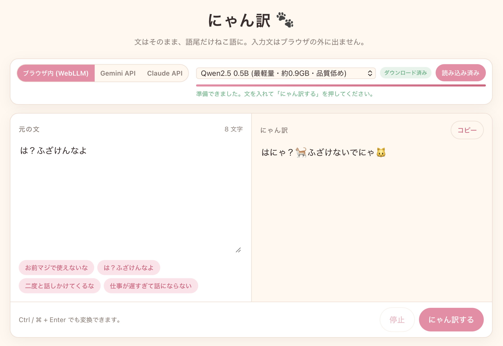

# にゃん訳 🐈

どんなにきつい言葉も「ねこ語」に変換して、世界をちょっとやさしくするツールです。
日本語の文をフォームに入れると、文はそのままに、語尾だけを「にゃ」に変えてくれます。
既定ではブラウザの中だけで変換が完結し、**入力した文はどこにも送信されません**。
お手持ちの Gemini / Claude の API キーを入れて、クラウドのモデルで変換することもできます (この場合は入力文が各社の API に送られます)。

**🐾 公開ページ: <https://rayjasm.github.io/nyanyaku/>**

## 使用例



## 使い方

1. <https://rayjasm.github.io/nyanyaku/> をブラウザで開きます。
2. エンジンを選びます。
   - **ブラウザ内 (WebLLM)**: モデルを選んで「モデルを読み込む」を押します。初回はモデルファイルのダウンロードに数分かかります。
   - **Gemini API / Claude API**: API キーを貼り付け、モデルを選びます。「モデル一覧を取得」を押すと、そのキーで使えるモデルが API から読み込まれます。
3. 変換したい文を入れて「にゃん訳する」を押すと、語尾がねこ語になった文が出てきます。
   - Ctrl / ⌘ + Enter でも変換できます。
   - 「停止」で生成を途中で止められます。

## ローカルで動かす

1. このリポジトリを clone し、ローカルサーバーを起動します。

   ```sh
   git clone https://github.com/rayjasm/nyanyaku.git
   cd nyanyaku
   python3 -m http.server 8000
   ```

2. ブラウザで <http://localhost:8000> を開きます。あとは公開ページと同じです。

## 仕組み

- [WebLLM](https://github.com/mlc-ai/web-llm) を使い、小型の LLM を WebGPU 経由でブラウザ内で動かしています。
- ブラウザ内モードでは、入力文は LLM へのプロンプトとしてブラウザ内で処理され、ネットワークには流れません。
- API モードでは、ブラウザから直接 Google (Gemini API) または Anthropic (Claude API) の REST API を呼び出し、ストリーミングで結果を受け取ります。サーバーは介在しません。
- 各文の終わりには 🐈 と 🐱 のどちらかをランダムに付けます。句点「。」は絵文字に置き換え、「！」「？」はそのまま残します (JavaScript 側で付けるので、モデルには絵文字を出させません)。
- LLM が指示を守らなかった場合に備えて、JavaScript 側で保険をかけています。
  - 文末に「にゃ」を補う、ラベルや引用符を外す、同じ文の繰り返しを除くなどの後処理
  - ブラウザ内モードでは、例文の答えをそのまま返した・入力がそのまま出た・空だった場合に、温度を下げて一度だけ再生成

## Gemini / Claude API を使う

WebGPU が使えない環境や、より高品質な変換がほしいときは、自分の API キーでクラウドのモデルを使えます。

| エンジン | キーの取得先 | 既定のモデル |
|---|---|---|
| Gemini API | [Google AI Studio](https://aistudio.google.com/apikey) | `gemini-3.8-flash` |
| Claude API | [Claude Console](https://platform.claude.com/settings/keys) | `claude-opus-5-5` |

- キーは **あなたのブラウザから直接** 各社の API に送られます。このページの作者やその他の第三者には渡りません。
- 「このブラウザに保存」にチェックを入れると、キーが localStorage に平文で保存されます。共用の端末ではチェックを外してください。「キーを消去」でいつでも削除できます。
- 利用料金は、あなたの API キーに対して各社から課金されます。
- Claude API では、安全分類器が応答を拒否した場合に別のモデルへ自動で振り替える `fallbacks: "default"` を有効にしています (対応モデルのみ)。

### 使えるモデル

| モデル | 目安サイズ | 特徴 |
|---|---|---|
| Gemma 2 2B 日本語版 (`gemma-2-2b-jpn-it-q4f16_1-MLC`) | 約 1.9GB | 既定。日本語の品質がいちばん良い |
| にゃんとぴあ Qwen3 0.6B (`nyantopia-Qwen3-0.6B-q4f16_1-MLC`) | 約 340MB | [Qwen3-0.6B](https://huggingface.co/Qwen/Qwen3-0.6B) を語尾の言い換え向けに学習させたもの ([jasmray/nyantopia-Qwen3-0.6B-q4f16_1-MLC](https://huggingface.co/jasmray/nyantopia-Qwen3-0.6B-q4f16_1-MLC)、Apache-2.0)。「二度と話しかけてくるな → 二度と話しかけてこないでにゃ」のように、命令や禁止のきつい語尾をやわらかくする。軽くて速い |

モデルを切り替えたら、もう一度「モデルを読み込む」を押してください。

## 動作要件

ブラウザ内モードの場合:

- WebGPU が使えるブラウザ (macOS なら最新の Chrome / Edge、Safari 17.4 以降)
- 空きメモリ 4GB 程度 (2B モデルの場合)
- 初回のみインターネット接続 (下記参照)

API モードの場合は WebGPU は不要で、インターネット接続と API キーがあれば動きます。

## プライバシーとネットワークについて

ブラウザ内モード (既定):

- **入力した文は一切送信されません。** 変換はすべてブラウザ内で行われます。
- **初回のみ**、次の 2 つをインターネットからダウンロードします。
  - WebLLM ライブラリ本体 (jsDelivr CDN)
  - モデルファイル (Hugging Face、約 1〜2GB)
- ダウンロードしたモデルはブラウザのキャッシュ (Cache API) に保存され、2 回目以降はオフラインでも動きます。

API モード:

- **入力した文とプロンプトは、選んだ会社 (Google または Anthropic) の API に送信されます。** 各社のデータ取り扱いポリシーが適用されます。
- 画面上部の見出しと注意書きで、いま入力文がどこへ行くかを常に表示しています。

## file:// で直接開いた場合

`index.html` をダブルクリックして `file://` で開くと、ブラウザの制限でモデルのキャッシュが効かなかったり、読み込みに失敗することがあります。
画面上部に警告が出た場合は、公開ページを使うか、上記の手順でローカルサーバー経由で開いてください。

## キャッシュの削除

ページ下部の「選択中モデルのキャッシュを削除」を押すと、選んでいるモデルのファイルをブラウザから削除します。
次回はあらためてダウンロードになります。

## ファイル構成

```
nyanyaku/
├── index.html   # アプリ本体 (HTML / CSS / JS をすべて内包)
├── README.md    # このファイル
├── LICENSE      # MIT ライセンス
└── docs/
    └── screenshot.png   # README 用のスクリーンショット
```

ビルド工程はありません。`index.html` を編集すればそのまま反映されます。

## ライセンス

このリポジトリのコード (`index.html` など) は [MIT ライセンス](LICENSE) です。自由に利用・改変・再配布できます。

利用している外部のものには、それぞれの提供元のライセンス・規約が適用されます。

- [WebLLM](https://github.com/mlc-ai/web-llm): Apache License 2.0。CDN から実行時に読み込んでおり、このリポジトリには含めていません。
- ブラウザ内モードで使うモデルは、ユーザーのブラウザが Hugging Face から直接ダウンロードします。利用には各モデルの規約が適用されます。
  - Gemma 2 2B 日本語版: [Gemma Terms of Use](https://ai.google.dev/gemma/terms)
  - にゃんとぴあ Qwen3 0.6B ([jasmray/nyantopia-Qwen3-0.6B-q4f16_1-MLC](https://huggingface.co/jasmray/nyantopia-Qwen3-0.6B-q4f16_1-MLC)): Apache License 2.0 (ベースモデルの [Qwen3-0.6B](https://huggingface.co/Qwen/Qwen3-0.6B) と同じ)
- Gemini API / Claude API は、ユーザー自身の API キーで呼び出します。Google および Anthropic の利用規約がユーザーに適用され、料金もユーザーのキーに課金されます。
